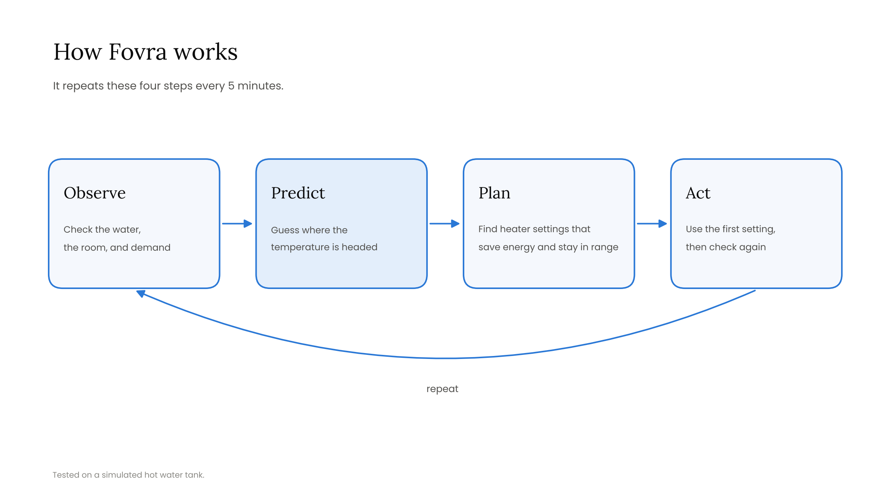
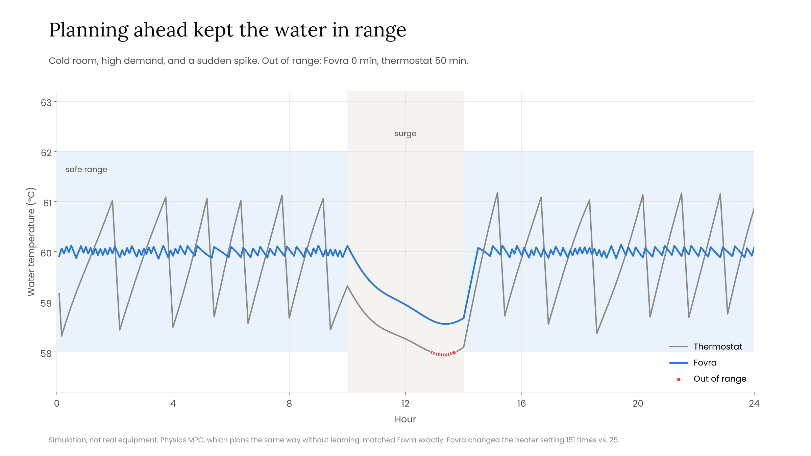
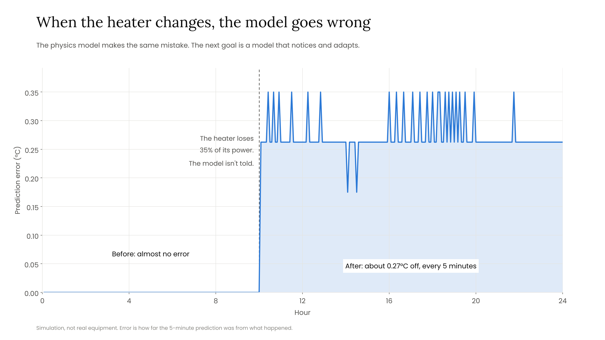

# Fovra v0

[](https://github.com/Grace-Fokam/fovra-v0/actions/workflows/tests.yml)

Fovra v0 explores whether a small machine learning model can learn how a physical system behaves and use that model to control it. It includes an original fixed-model benchmark and a separate online adaptation experiment.

The test system is a simulated hot water tank. A heater has to keep the water between 58 and 62°C while production pulls heat out. Fovra learns how the tank responds, looks 20 minutes ahead, and picks heater settings that balance temperature tracking, electricity use, and changes in power. Temperature limits use soft penalties, not guaranteed safety constraints.

It's all a simulation with made-up but reasonable numbers. It isn't real equipment, and it doesn't prove energy savings.



## Original benchmark and dashboard

In the original benchmark and dashboard, each controller gets the same simulated day. The learned and physics MPC models remain fixed throughout each run.

- **Thermostat.** Heater on below 59°C, off above 61°C.
- **PI controller.** A standard feedback controller used in industry.
- **Physics MPC.** Plans exactly like Fovra, but uses the tank's equation instead of a learned model. This one answers whether the learning helps, or only the planning.

## Shareable dashboard deployment

The dashboard can be hosted directly from this repository on **Streamlit Community Cloud**. See the [deployment and live-verification guide](docs/deploy-streamlit.md) for the exact GitHub repository, `main` branch, `app.py` entrypoint, Python version, and checks for both modes. Add the live URL here only after the hosted app has been verified.

## Run it

You'll need Python 3.10 or newer.

```bash
git clone https://github.com/Grace-Fokam/fovra-v0.git
cd fovra-v0
python3 -m venv .venv
source .venv/bin/activate
python -m pip install -r requirements.txt
python -m streamlit run app.py
```

The dashboard opens at `http://localhost:8501`. Choose **Original simulation** in Dashboard view. Pick a room temperature, a production demand, a scenario, and a controller to compare against, then click Run.

Other things you can run:

- `python run_example.py` saves the thermostat comparisons as CSVs in `examples/`
- `python benchmark_mpc.py --output results/mpc_comparison` reruns the full Fovra vs. Physics MPC comparison
- `python benchmark_adaptation.py --output results/adaptation` reruns the separate adaptation experiment
- `python -m pytest -q` runs the tests

## Dashboard modes

- **Original simulation** runs the existing fixed-model comparison with room temperature, demand, scenario, and baseline controls. Results are simulated on demand and cached.
- **Adaptation experiment** reads `results/adaptation/summary.csv`. Filter three equipment configurations, degraded or unchanged equipment, operating-condition seeds, and four controllers. It displays equal-weight matched-case means, a selectable metric chart, per-case records, and a CSV download. Tracking error, both on-policy and common-probe prediction error, electricity, and temperature violations are included. Empty selections show guidance.

The adaptation view never launches the benchmark or modifies recorded outputs. Trajectories are available through the offline benchmark CLI and CI artifacts, rather than through interactive execution. Full-day metrics and hours 10–24 prediction metrics are labeled separately. Conventional adaptive physics remains competitive. These synthetic linear, noiseless systems do not demonstrate real-world energy savings or an ML-specific advantage.

## Original benchmark scenarios

- **Normal.** Demand and room temperature drift a little through the day.
- **Production surge.** From hour 10 to 14, production needs 2.5 kW more, with no warning.
- **Heater degradation.** From hour 10, the heater only delivers 65% of its power. No controller is told.

## Original benchmark findings

**Planning ahead helps.** In a cold room with high demand and a surge, Fovra stayed in range. The thermostat dropped below 58°C for 50 minutes. Fovra changed the heater setting far more often, though (151 times vs. 25).



**Fixed learned and physics MPC match.** Fovra and Physics MPC made exactly the same choices in all 27 cases I tested. That makes sense: the simulator is a simple equation, so the model just learns that equation. This benchmark does not establish an advantage from learning the dynamics.

**The original fixed models become stale.** After the heater degrades, both keep making incorrect predictions because neither updates its model. The separate adaptation experiment below tests online updates under a different, feasible degradation protocol.



Energy use was about the same for every controller at normal settings (148.75 kWh for Fovra vs. 149.00 for the thermostat). A tank this simple doesn't leave much energy to save.

The full comparison, with every number and how it was measured, is in [docs/mpc-comparison.md](docs/mpc-comparison.md).

## Files

- `simulator.py`: the tank and the scenarios
- `train_model.py`: trains the model
- `controllers.py`: the thermostat, the PI controller, Physics MPC, and Fovra
- `evaluation.py`: runs the comparisons and computes the results
- `app.py`: the dashboard
- `run_example.py`: the thermostat comparisons, without the browser
- `benchmark_mpc.py`: the Fovra vs. Physics MPC comparison
- `results/mpc_comparison/`: saved results from that comparison
- `adaptive_mpc.py`: rolling learned regression and bounded physical-parameter identification
- `benchmark_adaptation.py`: the matched four-controller adaptation experiment
- `results/adaptation/`: per-case adaptation metrics, paired comparisons, and provenance
- `tests/`: tests for the simulation, the planners, the benchmark, and the dashboard

## Next

- Messier physics: sensor noise, delays, wear, and uneven heating
- Stronger feedback baselines: a well-tuned PID
- Test adaptation across noise levels, nonlinear drift, window sizes, and regularization
- A second system, like a pump
- Testing on an outside benchmark like [BOPTEST](https://ibpsa.github.io/project1-boptest/)

## Online adaptation experiment

**Updating stale models improves prediction and temperature tracking in this simulation. Conventional adaptive physics remains competitive, and energy use increases slightly.**

The [adaptation experiment](docs/adaptation-results.md) compares fixed learned MPC, fixed physics MPC, adaptive learned MPC, and adaptive physics MPC across 18 matched cases: three equipment configurations (including two unseen during nominal training), two change conditions, and three seeds. Each run lasts 24 hours. In nine degraded cases, heater efficiency unexpectedly falls by 25% at hour 10. Controllers are not told the change time or actual equipment parameters.

Both adaptive controllers fit the latest 48 completed transitions using only their own observed history. They share the original MPC planner. Predictions are scored before each update, and independent common prediction probes are used only for evaluation.

Means across the nine degraded cases:

| Controller | Temperature tracking RMSE (°C) | Electricity (kWh/day) | Safety violations (min/day) |
|---|---:|---:|---:|
| Fixed learned MPC | 0.222 | 161.611 | 0 |
| Fixed physics MPC | 0.222 | 161.611 | 0 |
| Adaptive learned MPC | 0.069 | 162.500 | 0 |
| Adaptive physics MPC | 0.073 | 162.500 | 0 |

Tracking error and electricity cover the full day. Post-change prediction error on each controller's actual operating trajectory falls from 0.195642°C/step for fixed learned MPC to 0.009812 for adaptive learned MPC and 0.016483 for adaptive physics MPC. Adaptive physics performs better on common prediction probes and recovers its model faster under the documented diagnostic threshold. Neither adaptive method is uniformly better.

Both adaptive controllers use 0.889 kWh/day more than the fixed controllers, about 0.55%. All four remain within the temperature band in these cases, so this does not establish a safety advantage.

These are three synthetic, linear, noiseless plants with repeated demand seeds. The results support online model adaptation, but do not establish an advantage unique to machine learning, real-world energy savings, or industrial validation. The original simulator and 27-case benchmark remain unchanged. The **Original simulation** dashboard mode continues to use fixed models. The separate **Adaptation experiment** mode explores the committed adaptation results. See the [full protocol, metrics, and limitations](docs/adaptation-results.md) and [per-case results](results/adaptation/summary.csv).

## License

MIT

