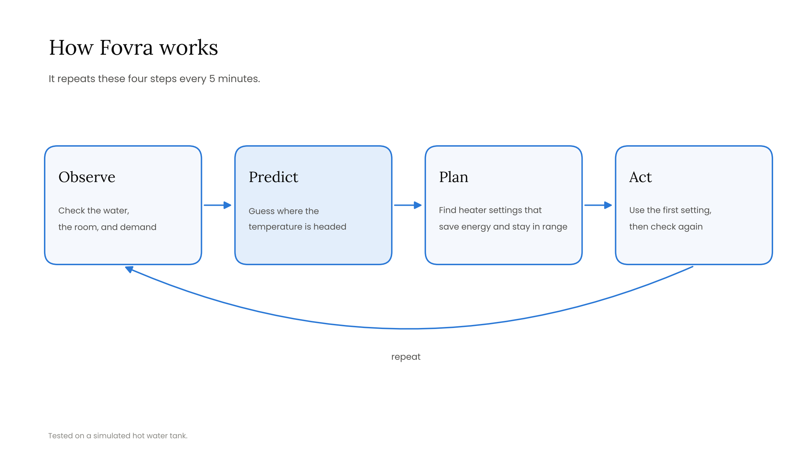
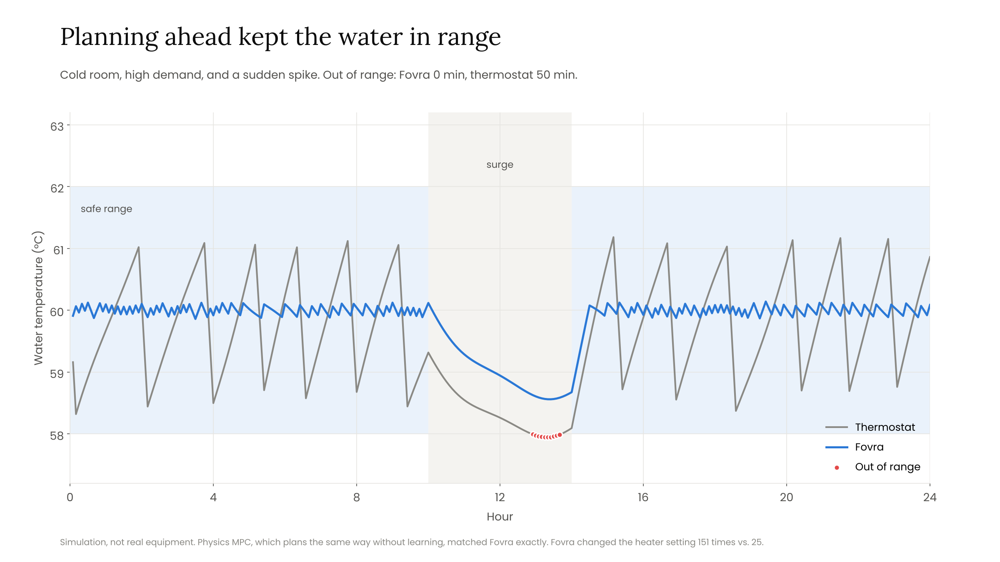
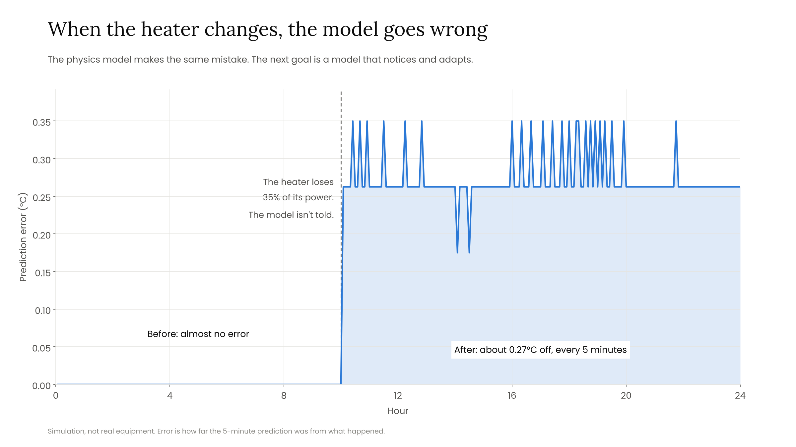

# Fovra v0

[](https://github.com/Grace-Fokam/fovra-v0/actions/workflows/tests.yml)

Fovra is exploring AI-assisted design of computer components, with computer cooling as an active research direction. This repository records early simulation research, including a cold-plate geometry search prototype and earlier control experiments. The precise component, customer requirements, and commercial product remain under consideration.

All reported performance is simulated. The research does not yet demonstrate validated cooling hardware, hardware novelty, real-world energy savings, or a general advantage from AI.

## Research overview

| Research track | What is implemented | Evidence boundary |
| --- | --- | --- |
| **Current component-design research: cold plates** | A command-line prototype searches straight-channel dimensions, conductivity, and flow using a reduced-order thermal/hydraulic model and equal-budget surrogate versus random search. | An unvalidated coupon model. Requires thermal-engineering review, conjugate CFD, and bench measurements. It does not model a complete GPU package or establish manufacturing feasibility. See [cold-plate research](docs/cold-plate.md). |
| **Supporting system-level exploration: data-center cooling** | A dashboard and benchmark compare dry cooling, evaporative assistance, equipment size, and operating settings. | Synthetic equipment and weather assumptions. This explores system configurations rather than new component geometry. AI screening matched random search seven times, improved once, and was worse once among nine feasible pairs. See [cooling exploration](docs/cooling-experiment.md). |
| **Historical control experiments: hot-water tanks** | Fixed-model MPC, online adaptation, and a separate sensor-noise/bias benchmark. | Synthetic control testbeds, separate from component design. Adaptive physics remains competitive and outperforms the current learned estimator under measurement noise. These results do not validate cooling hardware. See [fixed-model](docs/mpc-comparison.md), [adaptation](docs/adaptation-results.md), and [sensor-robustness](docs/sensor-robustness-results.md) reports. |

The dashboard has three modes: **Cooling exploration**, **Original simulation**, and **Adaptation experiment**. Cold-plate design and sensor robustness are separate command-line experiments. For environment-specific reproduction and commands that preserve recorded results, start with the [combined validation guide](docs/integration-validation.md). The recorded cold-plate outputs require a separate Python 3.12 environment with `requirements-cold-plate.txt` for byte-identical scientific results.

## Historical control testbed

The original test system is a simulated hot water tank. A heater has to keep the water between 58 and 62°C while production pulls heat out. Fovra learns how the tank responds, looks 20 minutes ahead, and picks heater settings that balance temperature tracking, electricity use, and changes in power. Temperature limits use soft penalties, not guaranteed safety constraints.

It's all a simulation with made-up but reasonable numbers. It isn't real equipment, and it doesn't prove energy savings.



## Original benchmark and dashboard

In the original benchmark and dashboard, each controller gets the same simulated day. The learned and physics MPC models remain fixed throughout each run.

- **Thermostat.** Heater on below 59°C, off above 61°C.
- **PI controller.** A standard feedback controller used in industry.
- **Physics MPC.** Plans exactly like Fovra, but uses the tank's equation instead of a learned model. This one answers whether the learning helps, or only the planning.

## Shareable dashboard deployment

The dashboard can be hosted directly from this repository on **Streamlit Community Cloud**. See the [deployment and live-verification guide](docs/deploy-streamlit.md) for the exact GitHub repository, `main` branch, `app.py` entrypoint, Python version, and checks for all three modes. Add the live URL here only after the hosted app has been verified.

## Run it

You'll need Python 3.10 or newer.

```bash
git clone https://github.com/Grace-Fokam/fovra-v0.git
cd fovra-v0
python3 -m venv .venv
source .venv/bin/activate
python -m pip install -r requirements.txt
python -m streamlit run app.py
```

The dashboard opens at `http://localhost:8501`. Choose **Original simulation** in Dashboard view. Pick a room temperature, a production demand, a scenario, and a controller to compare against, then click Run.

Other things you can run:

- `python run_example.py` saves the thermostat comparisons as CSVs in `examples/`
- `python benchmark_mpc.py --output results/mpc_comparison` reruns the full Fovra vs. Physics MPC comparison
- `python benchmark_adaptation.py --output results/adaptation` reruns the separate adaptation experiment
- `python benchmark_sensor_robustness.py --output results/sensor_robustness` reruns the separate noise and bias benchmark
- `python benchmark_cooling.py --output results/cooling` reruns the cooling grid and equal-budget AI/random search comparison
- `python benchmark_cold_plate.py --output results/cold_plate` runs the separate physical channel-geometry research experiment
- `python -m pytest -q` runs the tests

For integration checks that preserve recorded outputs, see [the combined validation guide](docs/integration-validation.md).

## Cold-plate geometry research

A separate command-line prototype searches physical channel width, depth, spacing, base thickness, conductivity, and flow. It uses a reduced-order laminar thermal/hydraulic model and compares a random-forest surrogate with random search under identical simulator-call budgets. A fixed-flow case isolates geometry changes. See [assumptions, equations, reproducible results, and required CFD/bench validation](docs/cold-plate.md). This is an unvalidated design-screening experiment, not demonstrated cooling hardware.

## Dashboard modes

- **Cooling exploration** compares dry cooling and evaporative assist under matched IT load and synthetic weather. It reports cooling electricity, makeup and evaporated water, estimated cooling emissions, utility cost, and coolant-temperature violations. Optional AI screening is compared with random search using the same simulation budget. Every reported candidate is checked in the simulator. See [model assumptions and results](docs/cooling-experiment.md).
- **Original simulation** runs the existing fixed-model comparison with room temperature, demand, scenario, and baseline controls. Results are simulated on demand and cached.
- **Adaptation experiment** reads `results/adaptation/summary.csv`. Filter three equipment configurations, degraded or unchanged equipment, operating-condition seeds, and four controllers. It displays equal-weight matched-case means, a selectable metric chart, per-case records, and a CSV download. Tracking error, both on-policy and common-probe prediction error, electricity, and temperature violations are included. Empty selections show guidance.

The adaptation view never launches the benchmark or modifies recorded outputs. Trajectories are available through the offline benchmark CLI and CI artifacts, rather than through interactive execution. Full-day metrics and hours 10–24 prediction metrics are labeled separately. Conventional adaptive physics remains competitive. These synthetic linear, noiseless systems do not demonstrate real-world energy savings or an ML-specific advantage.

## Original benchmark scenarios

- **Normal.** Demand and room temperature drift a little through the day.
- **Production surge.** From hour 10 to 14, production needs 2.5 kW more, with no warning.
- **Heater degradation.** From hour 10, the heater only delivers 65% of its power. No controller is told.

## Original benchmark findings

**Planning ahead helps.** In a cold room with high demand and a surge, Fovra stayed in range. The thermostat dropped below 58°C for 50 minutes. Fovra changed the heater setting far more often, though (151 times vs. 25).



**Fixed learned and physics MPC match.** Fovra and Physics MPC made exactly the same choices in all 27 cases I tested. That makes sense: the simulator is a simple equation, so the model just learns that equation. This benchmark does not establish an advantage from learning the dynamics.

**The original fixed models become stale.** After the heater degrades, both keep making incorrect predictions because neither updates its model. The separate adaptation experiment below tests online updates under a different, feasible degradation protocol.



Energy use was about the same for every controller at normal settings (148.75 kWh for Fovra vs. 149.00 for the thermostat). A tank this simple doesn't leave much energy to save.

The full comparison, with every number and how it was measured, is in [docs/mpc-comparison.md](docs/mpc-comparison.md).

## Files

- `simulator.py`: the tank and the scenarios
- `train_model.py`: trains the model
- `controllers.py`: the thermostat, the PI controller, Physics MPC, and Fovra
- `evaluation.py`: runs the comparisons and computes the results
- `app.py`: the dashboard
- `run_example.py`: the thermostat comparisons, without the browser
- `benchmark_mpc.py`: the Fovra vs. Physics MPC comparison
- `results/mpc_comparison/`: saved results from that comparison
- `adaptive_mpc.py`: rolling learned regression and bounded physical-parameter identification
- `benchmark_adaptation.py`: the matched four-controller adaptation experiment
- `results/adaptation/`: per-case adaptation metrics, paired comparisons, and provenance
- `benchmark_sensor_robustness.py`: separate sensor-noise and bias benchmark
- `results/sensor_robustness/`: matched sensor-robustness metrics and provenance
- `tests/`: tests for the simulation, the planners, the benchmark, and the dashboard

## Future work

These are research priorities, not a finalized product roadmap.

### Computer-component design and cooling

- Define a specific cooling-component use case with prospective collaborators and thermal engineers, including heat maps, package interfaces, inlet conditions, temperature and pressure limits, pump curves, and manufacturing constraints.
- Review the cold-plate model, then validate a preregistered set of candidates with conjugate CFD, mesh and conservation checks, real headers/ports, temperature-dependent properties, and nonuniform heating. Follow the [cold-plate validation gates](docs/cold-plate.md#outputs-tests-and-next-research-gate).
- After model review and CFD, fabricate reference and tradeoff candidates for calibrated thermal, flow, pressure, and pump-electrical measurements with uncertainty estimates.
- Compare search methods on expensive evaluations with locked budgets, conventional optimization baselines, and held-out geometries and conditions. The present cheap coupon model does not establish a surrogate speedup.
- For supporting system-level cooling work, replace assumed equipment curves with measured data or a detailed external simulator before testing noise, delays, failures, and unseen conditions.

### Historical control research

- Extend the existing sensor-noise/bias benchmark to estimator constraints, filtering, nonlinear drift, window sizes, and regularization.
- Investigate delays, wear, uneven heating, and stronger feedback baselines such as a well-tuned PID.
- Consider an external benchmark such as [BOPTEST](https://ibpsa.github.io/project1-boptest/) for control-method evaluation. This is a separate research track, not a commitment to a non-computer-hardware product.

## Online adaptation experiment

**Updating stale models improves prediction and temperature tracking in this simulation. Conventional adaptive physics remains competitive, and energy use increases slightly.**

The [adaptation experiment](docs/adaptation-results.md) compares fixed learned MPC, fixed physics MPC, adaptive learned MPC, and adaptive physics MPC across 18 matched cases: three equipment configurations (including two unseen during nominal training), two change conditions, and three seeds. Each run lasts 24 hours. In nine degraded cases, heater efficiency unexpectedly falls by 25% at hour 10. Controllers are not told the change time or actual equipment parameters.

Both adaptive controllers fit the latest 48 completed transitions using only their own observed history. They share the original MPC planner. Predictions are scored before each update, and independent common prediction probes are used only for evaluation.

Means across the nine degraded cases:

| Controller | Temperature tracking RMSE (°C) | Electricity (kWh/day) | Safety violations (min/day) |
|---|---:|---:|---:|
| Fixed learned MPC | 0.222 | 161.611 | 0 |
| Fixed physics MPC | 0.222 | 161.611 | 0 |
| Adaptive learned MPC | 0.069 | 162.500 | 0 |
| Adaptive physics MPC | 0.073 | 162.500 | 0 |

Tracking error and electricity cover the full day. Post-change prediction error on each controller's actual operating trajectory falls from 0.195642°C/step for fixed learned MPC to 0.009812 for adaptive learned MPC and 0.016483 for adaptive physics MPC. Adaptive physics performs better on common prediction probes and recovers its model faster under the documented diagnostic threshold. Neither adaptive method is uniformly better.

Both adaptive controllers use 0.889 kWh/day more than the fixed controllers, about 0.55%. All four remain within the temperature band in these cases, so this does not establish a safety advantage.

These are three synthetic, linear, noiseless plants with repeated demand seeds. The results support online model adaptation, but do not establish an advantage unique to machine learning, real-world energy savings, or industrial validation. The original simulator and 27-case benchmark remain unchanged. The **Original simulation** dashboard mode continues to use fixed models. The separate **Adaptation experiment** mode explores the committed adaptation results. See the [full protocol, metrics, and limitations](docs/adaptation-results.md) and [per-case results](results/adaptation/summary.csv).

## Sensor robustness experiment

**The current adaptive physics controller handles measurement noise better than the current adaptive learned controller in this synthetic suite. Neither reliably recovers the underlying model under random sensor noise.**

Run `python benchmark_sensor_robustness.py`. This separate experiment adds Gaussian temperature noise (standard deviations 0.1, 0.5, and 1.0°C), constant ±1°C sensor bias, and combined noise/bias conditions. The physical dynamics and original experiments are unchanged. All four controllers receive their own noisy observations under the same protocol. Only the evaluator sees true temperatures.

Across 18 matched cases per sensor condition, 0.5°C noise produces mean tracking RMSE of 0.238°C for adaptive physics versus 0.423°C for adaptive learned MPC. At 1.0°C noise, the corresponding errors are 0.378°C and 1.743°C. Adaptive physics has no sampled temperature-band violations across the 144 cases, while the learned adaptive controller has violations in 48. These are simulated outcomes, not a safety guarantee. Neither adaptive method reaches the common clean-probe model-recovery threshold in any degraded case with random sensor noise, including 0.1°C noise.

See [the protocol, results, and limitations](docs/sensor-robustness-results.md). This supports a robustness advantage for the present constrained physics estimator over the present unconstrained regression estimator, not an ML-specific advantage or industrial validation. The Streamlit adaptation explorer continues to display the original noiseless results.

## License

MIT

